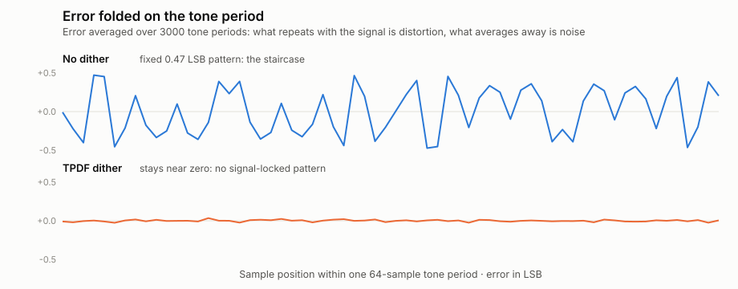
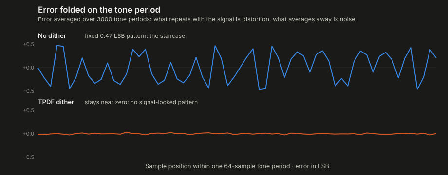
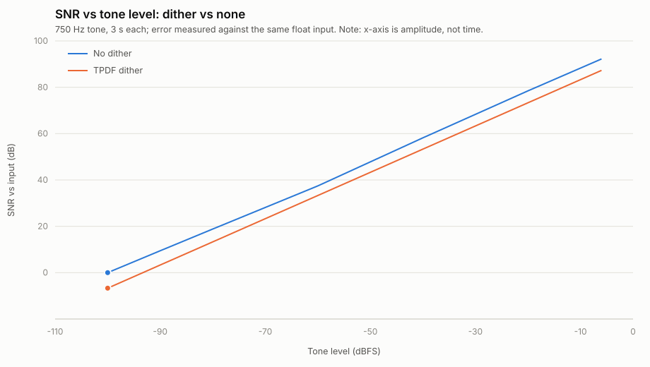
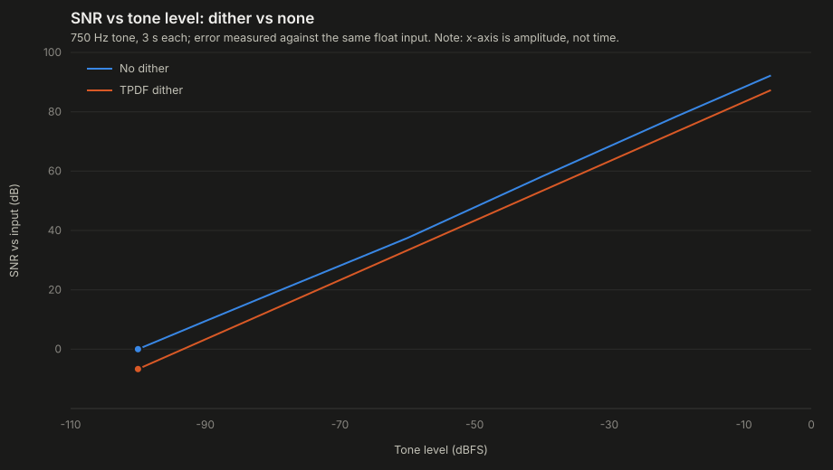
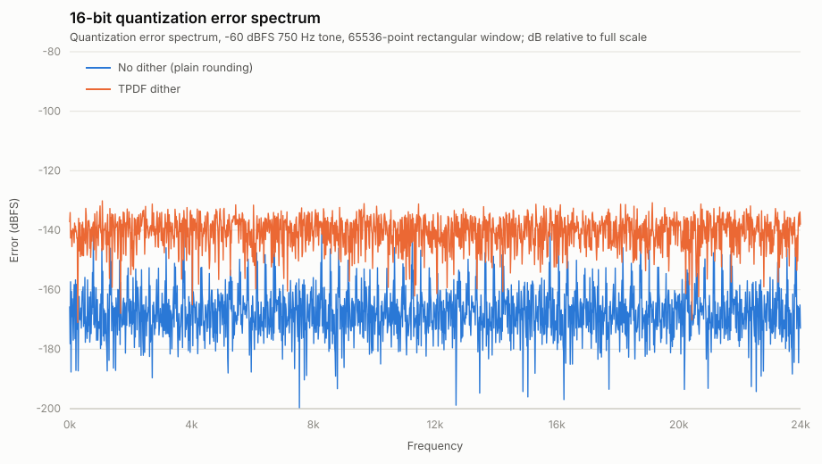
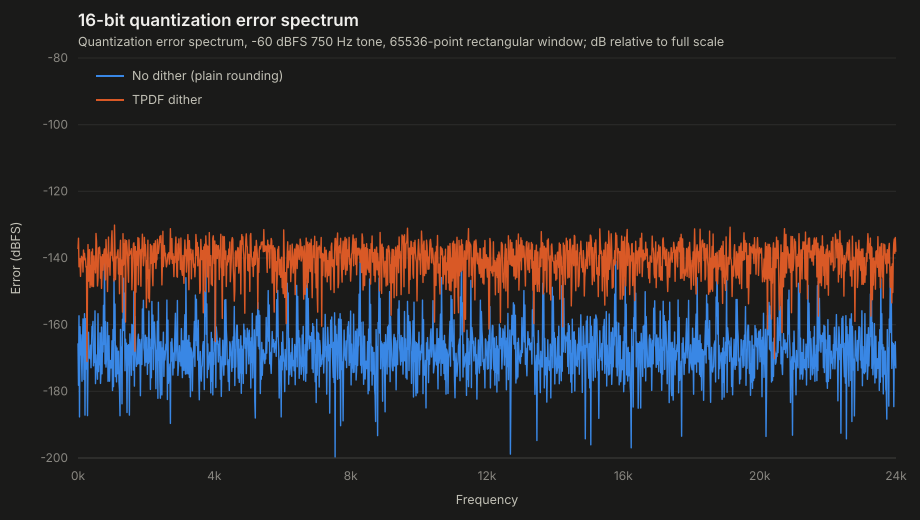
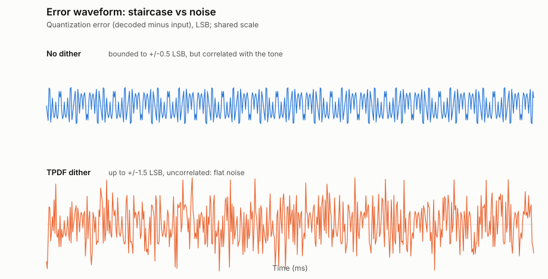
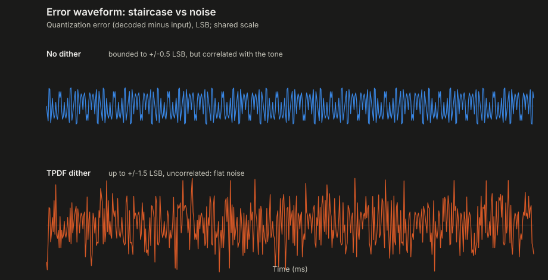
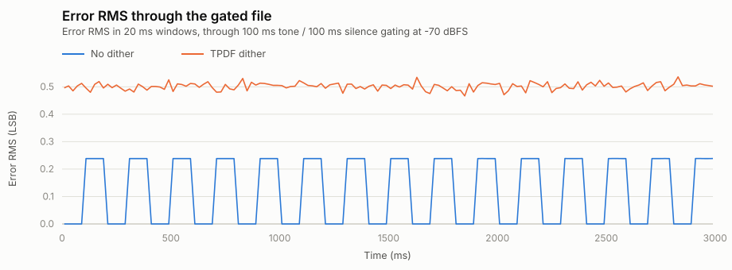
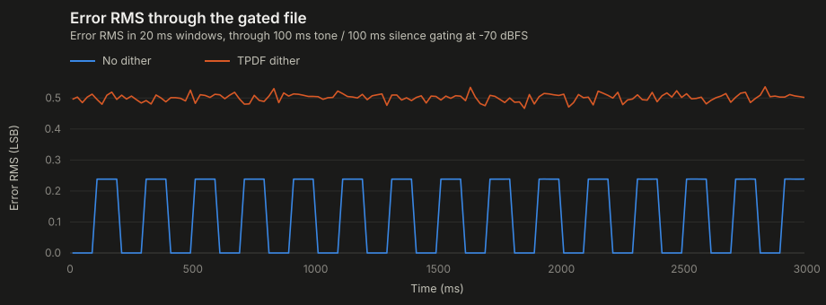

# 16 位导出抖动：量化误差的证据包

结论先行：**未加抖动的 16 位导出，误差不是噪声，而是与信号锁定的确定性失真。**
在 -60 dBFS 的正弦上，误差的 93% 可按 64 采样周期复现（折叠后仍是 0.30 LSB rms 的固定曲线），
听感上表现为与音高绑定的"颗粒感"和高次谐波；
TPDF 抖动把误差变成与信号无关的白噪声，同一测量下折叠部分只剩 0.1%，
代价是误差方差从 0.096 LSB² 升到 0.251 LSB²（约 4 dB 的 SNR 让渡）。
抖动关闭时，导出路径逐字节等于纯舍入，与 RNG 流和种子无关。

本目录是可复跑的证据包：三份要求——**信噪比、噪声频谱、与无抖动结果的对照**——都由
`./evidence/run_all.sh` 从源码重新生成，测量脚本只读 WAV 文件，不链接被测 C 代码。

```bash
cd dither
make test                 # 21 项 C 自检
./evidence/run_all.sh     # 导出 WAV + 独立校验 + 图表 + 本报告的表格数据
```

---

## 1. 抖动做了什么

量化器的约定（`src/dither_core.c`）：

```
v = x * 32768
q = clamp(floor(v + d + 0.5), -32768, 32767)      d = TPDF, 无抖动时为 0
y = q / 32768
```

- 用 32768 而非 32767 作刻度，一个量化步长恰好是解码域里的 1.0 LSB，满刻度误差均值为零。
- TPDF（三角分布）= 两个独立均匀分布之和，支撑在 (-1, 1) LSB，恰好覆盖两个量化台阶。
- 随机源是 PCG32，固定种子 ⇒ 固定抖动序列 ⇒ **可复现的字节**。

### 为什么"无抖动"的低电平误差是失真而不是噪声

舍入误差 `e = quant(x) - x` 是输入小数部分的确定性函数，因此与信号强相关。
对周期性信号，误差也以同样的周期重复——这就是"量化失真"。
抖动在舍入前混入独立随机量，把这一确定性映射打散，误差才成为与信号无关的噪声。
下面的折叠图直接测量这一点：把误差按 64 采样周期（750 Hz 在 48 kHz 下的整周期）对齐求平均，
能保留下来的部分就是随信号重复的失真，平均掉的部分才是噪声。




- 无抖动：折叠后是峰峰值约 0.94 LSB（峰值 ±0.47）的固定折线，rms 0.30 LSB，占总误差功率 **93.1%**；残差只有 0.08 LSB。
- TPDF：折叠曲线在 ±0.035 LSB 内起伏，折叠部分只占 **0.1%**，误差几乎全是噪声。

---

## 2. 信噪比

"SNR" 这里指 **输入信号功率 / 量化误差功率**（误差 = 解码输出 − 输入，直接由导出的 WAV 与
同一份 float 输入对减得到）。这是最朴素、也最容易被误读的指标：在低电平，无抖动的数字**更好看**，
因为这个比值把误差的"结构性"完全掩盖了。请看同一行右侧的失真占比。

| 信号 | 抖动 | SNR | 误差 rms | 误差峰值 | 折叠失真占比 |
|---|---|---|---|---|---|
| -60 dBFS 750 Hz | 无 | **37.46 dB** | 0.311 LSB | 0.50 LSB | **93.1%** |
| -60 dBFS 750 Hz | TPDF | 33.30 dB | 0.501 LSB | 1.49 LSB | 0.1% |
| -70 dBFS 门控 | 无 | 29.75 dB | 0.169 LSB | 0.44 LSB | 100.0% |
| -70 dBFS 门控 | TPDF | 20.28 dB | 0.502 LSB | 1.43 LSB | 0.1% |
| -6 → -90 dBFS 衰减 | 无 | 79.32 dB | 0.285 LSB | 0.50 LSB | 0.2%* |
| -6 → -90 dBFS 衰减 | TPDF | 74.43 dB | 0.501 LSB | 1.48 LSB | 0.1% |

\* 衰减信号不是稳态音，折叠只在电平较低的后半段成立，整段统计因此被高电平部分稀释；
逐电平的结论见下一节。

### 电平扫描：无抖动的优势随电平下降而瓦解

| 电平 dBFS | 无抖动 SNR | TPDF SNR | 无抖动误差 rms | TPDF 误差 rms | 无抖动折叠占比 |
|---|---|---|---|---|---|
| -6 | 92.24 dB | 87.30 dB | 0.284 LSB | 0.501 LSB | 0.6% |
| -20 | 78.47 dB | 73.31 dB | 0.276 LSB | 0.501 LSB | 4.8% |
| -40 | 58.19 dB | 53.31 dB | 0.285 LSB | 0.501 LSB | 64.2% |
| -60 | 37.46 dB | 33.30 dB | 0.311 LSB | 0.501 LSB | 93.1% |
| -80 | 18.83 dB | 13.30 dB | 0.265 LSB | 0.501 LSB | 100.0% |
| -90 | 9.44 dB | 3.29 dB | 0.247 LSB | 0.502 LSB | 100.0% |
| -100 | 0.00 dB | −6.70 dB | 0.232 LSB | 0.501 LSB | 100.0% |

读出三件事：

1. **误差 rms 几乎不随电平变**——无抖动 0.23–0.31 LSB，抖动恒为 0.50 LSB。
   这就是"量化噪底"的含义。无抖动的 SNR 并非真的更好，它只是误差更小；信号一弱，这个优势就不再有意义。
2. **两条曲线都以约 1 dB/dB 下降**（-6→-100 dBFS，无抖动掉 92.2 dB，抖动掉 94.0 dB），
   因为横轴是电平、纵轴是同一个误差底。两条线并不严格平行：无抖动只在高电平领先 4.9 dB，
   到 -100 dBFS 时反过来落后 6.7 dB（后者的误差底比前者大，低电平下 SNR 由误差底单独决定）。
3. **真正的分界是折叠占比，不是 SNR。** -20 dBFS 以上，无抖动的误差基本是噪声（<5%）；
   -40 dBFS 以下迅速变成失真（64%→100%）。抖动把这一转变点完全消除（全程 0.1%）。

也就是说，抖动不是"提高 SNR"，而是**在低电平把可听的失真换成不可听的白噪声**，代价约 4 dB。
这一条只在低电平成立：-6 dBFS 时无抖动的折叠占比只有 0.6%，抖动几乎纯让渡 SNR；-40 dBFS 以下则是抖动明显更优。




---

## 3. 噪声频谱

-60 dBFS、750 Hz 正弦（48 kHz 下每周期恰好 64 采样），误差用 65536 点矩形窗 FFT，
纵轴为相对满刻度的 dBFS（满刻度正弦在其频点处为 0 dBFS）。

| 抖动 | 误差底噪中位数 | 最强谐波（相对音） | 最强谐波绝对电平 | 高出底噪 | 总误差（相对信号） | 谐波失真 | 宽带噪声 |
|---|---|---|---|---|---|---|---|
| 无 | −168.2 dBFS/bin | **−39 dB**（第 15 次） | −99 dBFS | **69 dB** | −37.5 dB | **−34.7 dB** | −51.7 dB |
| TPDF | −140.0 dBFS/bin | −71 dB（第 28 次） | −131 dBFS | 9 dB | −33.3 dB | −61.0 dB | −30.3 dB |

这张表是整份材料的核心对比：

- **无抖动**：误差是离散谱线。底噪中位数极低（−168 dBFS/bin），但各次谐波上立着尖峰：
  第 15 次（11.25 kHz）相对音 −39 dB、第 5 次 −44 dB、第 11/17 次 −44 dB。
  在 −60 dBFS 素材上这些尖峰绝对电平约 −99 dBFS，比同一信号的底噪中位数高 69 dB。
  它们合起来构成 −34.7 dB 的谐波失真——这就是低电平正弦听起来"发毛"或带音高的原因。
- **TPDF**：底噪抬高约 28 dB 到 −140 dBFS/bin，但没有任何谐波分量高出底噪 9 dB 以上
  （最强为第 28 次，−71 dB 相对音），谐波总功率 −61 dB——线谱变成了平噪底。




> 说明：蓝线的底噪比橙线低约 28 dB，但那是逐频点的**中位数**；蓝线同时在谐波频点上有很窄的尖峰，
> 其绝对电平比蓝线自己的底噪高出 69 dB。听感由尖峰决定，而不是由中位数决定。

---

## 4. 与无抖动结果的对照

### 4.1 字节层面的对照

同一信号、同一导出工具、同一份 750 Hz 素材，分别关/开抖动：

| 信号 | 不同采样数 | 占比 | 无抖动数字静音采样 | TPDF 数字静音采样 |
|---|---|---|---|---|
| -60 dBFS 音 | 50,093 | 34.8% | 4,500 | 3,384 |
| -6→-90 dBFS 衰减 | 47,928 | 33.3% | 7,332 | 6,821 |
| -70 dBFS 门控 | 40,316 | 28.0% | 74,250 | 56,128 |

"数字静音采样"指编码值恰为 0 的采样。门控文件共 72,000 个静音段采样与 72,000 个音段采样：
无抖动时静音段 **72,000 个全部编为 0**（另有 2,250 个 0 来自音段里 |x| < 0.5 LSB 的部分）；
抖动后静音段只剩 53,874 个 0（约 25% 的采样被换成 ±1），静音不再"死寂"。

### 4.2 听觉形态的对照







- 误差波形：无抖动是随波形起伏的阶梯（峰值严格 ≤ 0.5 LSB），抖动是幅度可达 1.49 LSB 的随机噪声。
- 门控文件：无抖动的误差 RMS 在 100 ms 开关周期里从 0.24 LSB 直接掉到 0（数字静音），
  这是"呼吸感 / 颗粒感"的来源；TPDF 保持 0.50 LSB 恒定，音与静音之间没有底噪跳变。

### 4.3 逐字节一致性（关闭抖动后）

`./evidence/run_all.sh` 里的 `repro.txt` 会验证并输出：

```
repro_same_seed_identical=1        # 开抖动、同种子，两次运行逐字节相同
repro_matches_bundle=1             # 与仓库内导出的 WAV 逐字节相同
dither_off_seed_independent=1      # DITHER=off 时，换种子也逐字节相同
dither_off_matches_bundle=1        # DITHER=off 与无抖动参考逐字节相同
different_seed_changes_bytes=1     # 换种子确实会改变抖动输出（抖动是活的）
```

另外，独立校验器（Python，只读 WAV 与 `.f32` 旁路）对每份无抖动 WAV 用
`floor(x*32768 + 0.5)` 重算全部编码并与文件逐采样比对，三份文件的失配数均为 **0**。
这比"自己和自己比"更强：它证明关抖动时走的就是纯舍入，没有残留的随机项或状态。

`evidence/out/rails.txt` 还固定了编码边界：−1.0 → −32768、+1.0 → 32767、
32766/32768 的满刻度输入加上最多 1 LSB 抖动后仍不越界。

---

## 5. 误差方差账本

对 -60 dBFS 正弦（32.8 LSB 幅度，覆盖多个台阶）：

| 项 | 值 | 理论 |
|---|---|---|
| 无抖动误差方差 | 0.0964 LSB² | 取决于信号与台阶的对齐，没有固定值 |
| TPDF 误差方差 | 0.2511 LSB² | 0.25 LSB²（下式） |
| 方差比 | 2.60× | +4.16 dB 误差功率 |

分解：TPDF 本身的方差 = 两段均匀分布各 D²/12 相加 = D²/6 = 0.167 LSB²（实测 0.1671）；
舍入残差 1/12 = 0.083 LSB²；两者之和 0.25 LSB²，实测 0.2511（吻合 0.4%）。
这里不需要额外的相关项——抖动与舍入残差在统计上独立，方差直接相加。
误差 rms 由无抖动的 0.311 LSB 升到 0.501 LSB，比值 1.61（+4.16 dB）——这就是第 2 节 SNR 让渡的来源。

---

## 6. 结论与工程建议

1. **16 位导出默认开 TPDF 抖动。** 高电平下多付约 5 dB 的 SNR，换低电平彻底消失的量化失真
   （-60 dBFS 时无抖动误差 93% 是失真，抖动后 0.1%）。对游戏音频里大量的衰减尾音、环境底噪，这笔交易是划算的。
2. **不要在低电平信号上拿"SNR"当质量指标**——无抖动在 -60 dBFS 的 SNR 是 37 dB，比抖动高 4 dB，
   但它的误差 93% 是失真。折叠占比、谐波相对电平、杂散与底噪的差距才是可听性的判据。
3. **满刻度峰值留 1 LSB 余量。** TPDF 会把 +1.0 推到编码 32768 后被削顶（自检里
   `fullscale_clip_pos_rail` 覆盖此行为：+1.0 输入下削顶数 > 0，而 32766/32768 输入下为 0）；
   将上限设在 32766/32768，或先限幅（`limiter/` 已提供）。
4. **抖动需要可复现。** 固定种子 + 固定算法 ⇒ 同一工程每次导出字节一致，便于回归对比和交付校验。

---

## 7. 文件清单

```
dither/
├── include/dither.h             接口：RNG、量化器、误差报告
├── src/dither_core.c            TPDF 抖动 + 16 位量化（被测核心）
├── src/dither_test.c            21 项 C 自检（make test）
├── src/dither_export.c          WAV 导出 CLI（tone60 / sweep / gated，DITHER=on|off）
├── evidence/run_all.sh          一键复跑全部证据
├── evidence/verify_dither.py    独立校验器（只读 WAV/.f32，不链接 C 代码）
├── evidence/check_rails.py      编码边界与方差预算的交叉验证
├── evidence/wav/                导出结果（*.wav + 对应的 *.f32 原始输入）
└── evidence/out/                自检输出、校验报告、指标 JSON、图表 SVG、SHA-256
```

复现命令：

```bash
make -C dither test
dither/evidence/run_all.sh
```

所有数值来自 `evidence/out/metrics.json`；图表由 `verify_dither.py` 从同一份 WAV 生成。
