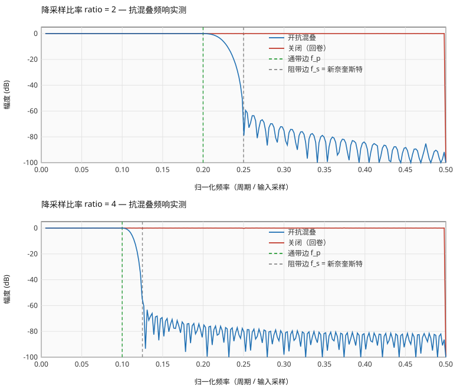

# resampler

`make test` 跑自检。`make measure` 重新生成抗混叠测量材料（`doc/`）。

## 抗混叠低通（降采样，ratio > 1）

旧实现直接线性插值抽取：高于新奈奎斯特频率的成分全部回卷进保留频带，
听感上就是刺耳的高频杂音。现在 ratio > 1 时先过一级 Kaiser 窗 sinc FIR
低通再插值抽取。

### 由截止频率推阶数与衰减量

频率对输入采样率归一化（单位：周期/输入采样）：

| 量 | 公式 | 说明 |
|---|---|---|
| 新奈奎斯特 | f_nyq = 0.5 / ratio | 高于它的成分会回卷 |
| 通带边 | f_p = 0.4 / ratio | 保留新频带的 80% |
| 阻带边 | f_s = 0.5 / ratio = f_nyq | |
| 过渡带 | Δf = f_s − f_p = 0.1 / ratio | |
| 目标阻带衰减 | A = 60 dB | 回卷残留压到节目素材掩蔽阈以下 |
| 阶数（Kaiser 经验式） | N ≥ (A − 7.95) / (14.36·Δf) + 1 ≈ 36.2·ratio + 1 | 向上取奇数（Ⅰ 型、整数组延迟） |
| Kaiser β（A > 50） | β = 0.1102·(A − 8.7) ≈ 5.65 | |
| sinc 截止（−6 dB 点） | f_c = (f_p + f_s) / 2 = 0.45 / ratio | |

代入：ratio = 2 → N = 75 阶；ratio = 4 → N = 147 阶。冲激响应按直流增益
归一（DC 无损）。设计在运行时按 ratio 现算，任意比率都满足同一套
f_p / f_s / A 约束。

### 实测频响（通带与阻带曲线）

正弦扫频实测（蓝 = 开抗混叠，红 = 关闭即旧行为，虚线 = 通带边/阻带边）：

| 比率 | 通带平坦度 | 阻带峰值 |
|---|---|---|
| 2.0 | ±0.04 dB | −59.4 dB |
| 4.0 | ±0.04 dB | −60.4 dB |

关闭滤波时阻带成分几乎 0 dB 原样回卷——就是旧实现刺耳声的直接证据。

### 混叠能量（输入全部位于阻带，输出即回卷残留）

| 比率 | 输入 RMS | 输出 RMS（关滤波） | 输出 RMS（开滤波） | 抑制 (dB) |
|---|---|---|---|---|
| 2.0 | 0.1442 | 0.1442 | 0.000037 | 71.8 |
| 4.0 | 0.1441 | 0.1438 | 0.000015 | 79.5 |

### 耗时（1M 采样，5 次取最优，毫秒）

| 比率 | 关滤波 | 开滤波 | 倍数 |
|---|---|---|---|
| 2.0 | 1.12 | 29.70 | 26.6x |
| 4.0 | 0.57 | 67.98 | 120.1x |

代价主要来自卷积 O(输入长度 × 阶数)，阶数随比率线性增长（36.2·ratio），
所以比率越大越慢；29.7 µs/千采样（ratio 2）对实时音频仍绰绰有余。

### 兼容性

- `resample_linear` 签名不变，默认开启抗混叠。
- `resampler_set_antialias(0)` 关闭后走原始代码路径，输出与旧实现
  **逐字节一致**（自检 `off_byte_identical` 与 `make measure` 双重验证：
  与旧算法逐字节 memcmp，ratio 2.0 / 4.0 / 1.3 / 0.5 全通过）。
